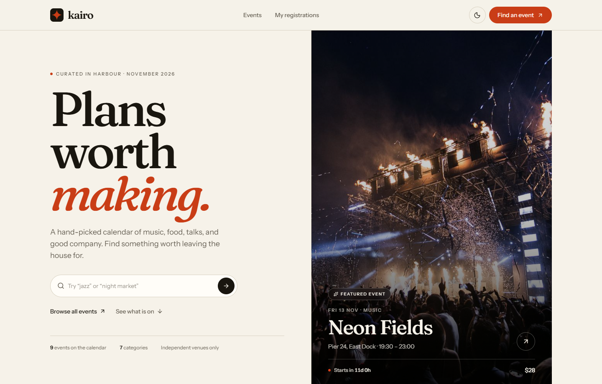

# Kairo

A curated event calendar built with React, TypeScript, and Tailwind CSS. Browse upcoming events, narrow the list by category, read the details, and save a spot with a validated registration form.

The design is deliberately editorial: warm paper tones, large serif headings, ruled sections, and restrained motion instead of the usual gradient-and-glass event template.



## Live demo

Deployment is configured for Vercel and Netlify. Add the final URL here once the project is deployed.

## Features

- **Home page** with a featured event, live countdown, quick search, next events, category index, and editorial sections.
- **Event discovery** with URL-backed text search and category filters. Search covers event name, venue, city, address, category, and summary.
- **Event detail pages** with date, time, venue, price, capacity, event notes, organiser details, related events, and a registration sidebar.
- **Validated registration** for name, email, and phone, with inline errors, focus management, duplicate prevention, and a confirmation screen with a reference code.
- **Saved registrations** on a dedicated page, including the ability to cancel a place.
- **Dark and light themes** with a no-flash boot script and system-preference fallback.
- **Responsive layout** from 320 px phones through tablets to wide desktops.
- **Accessible interactions**: skip link, labelled fields, `aria-invalid` and error associations, keyboard-friendly menus, visible focus states, and reduced-motion support.
- **SPA deployment config** for Vercel and Netlify, plus custom 404 pages for both unknown routes and unknown event slugs.

All registrations are stored in the browser. There is no backend, account system, or payment processing.

## Stack

| Tool | Version |
| --- | --- |
| React | 19.3.1 |
| React DOM | 19.3.1 |
| React Router | 7.18.5 |
| TypeScript | 7.0.2 |
| Vite | 8.3.5 |
| Tailwind CSS | 4.3.3 |
| lucide-react | 1.66.0 |
| Fonts | Fraunces Variable, Instrument Sans Variable via Fontsource |

The project uses Tailwind CSS v4 through `@tailwindcss/vite` and the React Compiler through `@vitejs/plugin-react` with the Babel preset.

## Getting started

Requirements: Node.js 20.19+ or 22.12+ (Node 24 is recommended), and npm.

```bash
npm install
npm run dev
```

Open the URL printed by Vite, normally <http://localhost:5173>.

### Scripts

| Command | Purpose |
| --- | --- |
| `npm run dev` | Start the Vite development server |
| `npm run build` | Type-check with `tsc -b` and create a production build in `dist/` |
| `npm run preview` | Preview the production build locally |
| `npm run lint` | Run Oxlint |

## Routes

| Route | Page |
| --- | --- |
| `/` | Home |
| `/events` | Event listing, search, and category filters |
| `/events/:slug` | Event detail |
| `/events/:slug/register` | Registration form |
| `/registrations` | Registrations saved on this device |
| `*` | 404 page |

Search and category state live in the query string, for example `/events?q=jazz` or `/events?category=Music`. This makes filtered views shareable and survives a refresh.

## How registration works

1. The form validates on submit and after a field has been touched.
2. Name: 2–80 characters, letters plus spaces, apostrophes, full stops, and hyphens.
3. Email: a practical address format check with a 254-character limit.
4. Phone: digits, spaces, brackets, dots, hyphens, and an optional leading `+`; 7–15 digits in total.
5. A second registration for the same event and email is blocked in the same browser.
6. On success, a registration is stored in `localStorage` under `kairo.registrations` with a reference in the form `KAI-XXXXXX`.
7. The confirmation screen resets scroll, moves focus to its heading, and links to the saved registrations page.
8. Registrations can be cancelled from `/registrations`. Clearing browser data removes all of them.

Theme preference is stored under `kairo.theme`. The inline script in `index.html` applies it before React renders to avoid a light flash.

### Event dates

Demo event dates are generated relative to the day the site is opened, so the calendar always contains upcoming events. This is intentional for a portfolio demo. In a production version, these dates would come from an API or CMS.

## Project structure

```text
src/
  components/        Reusable UI, layout, forms, cards, and navigation
  context/           Registration provider and context definition
  data/events.ts     Event catalogue and relative-date generation
  hooks/             Theme, countdown, document title, registrations
  lib/               Date formatting, validation, storage, registration helpers
  pages/             Route-level pages
  types.ts           Shared event, category, and registration types
  index.css          Tailwind theme tokens, base styles, and motion
  main.tsx           App entry point and font imports
public/
  images/            Local event photography
  favicon.svg        Kairo mark
  _redirects         Netlify SPA fallback
vercel.json          Vercel SPA rewrite
```

## Design notes

- Colours are defined as semantic CSS variables in `src/index.css` and exposed to Tailwind with `@theme inline`, so light and dark mode share component classes.
- Display type is Fraunces; body and UI type is Instrument Sans. Both are self-hosted through Fontsource.
- Motion is limited to page entry, scroll reveals, hover states, the countdown, and the category marquee. `prefers-reduced-motion` disables non-essential movement.
- Images are local rather than hot-linked, with descriptive alt text on cards, hero images, and detail pages.

## Deployment

### Vercel

1. Import the repository in Vercel.
2. Framework preset: **Vite**. Build command: `npm run build`. Output directory: `dist`.
3. Deploy. `vercel.json` rewrites all paths to `index.html` so client-side routes work on refresh.

### Netlify

1. Import the repository in Netlify.
2. Build command: `npm run build`. Publish directory: `dist`.
3. Deploy. `public/_redirects` provides the SPA fallback.

### GitHub Pages

The router uses `BrowserRouter`, so GitHub Pages needs a 404 fallback and a repository base path. Vercel or Netlify is the simpler option for this project. If Pages is required, add a `base` to `vite.config.ts` and a `404.html` copy step, or switch to `HashRouter`.

## Quality checks

The production build and lint pass locally. The main flows were exercised in Edge with Playwright at 1440, 768, 390, and 320 px widths:

- Light and dark mode persistence
- Hero search and category filtering
- Empty search results
- Event detail and countdown
- Empty and invalid form submissions
- Successful registration and duplicate blocking
- Registration cancellation
- Mobile menu, 404 routes, scroll reset, and confirmation focus
- No horizontal overflow and no browser console errors

## Photography

Photography is sourced from [Pexels](https://www.pexels.com) and used under the [Pexels license](https://www.pexels.com/license/). Images are included locally in `public/images` for demo reliability. If you reuse the project, review the license for each source image or replace the photography with your own.

## Scope

Kairo is a front-end demo. It does not send confirmation emails, process payments, verify capacity across devices, or persist data to a server. Registration data belongs to the browser that created it.
